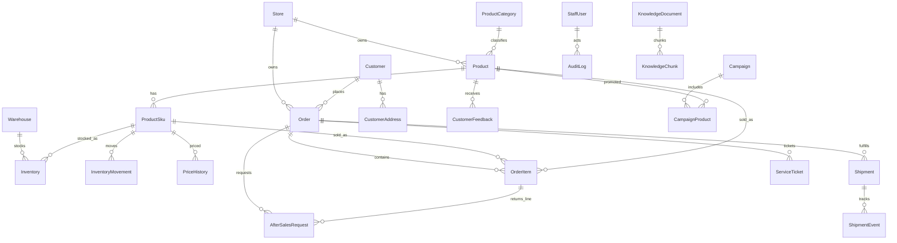

# E-commerce Business Copilot — Database Design V1.2.3

> 文档性质：**数据模型契约**（选型 + 逻辑模型 + 物理表规格 + Tool/场景履约映射）  
> 版本：**V1.2.3**  
> 状态：**Frozen**（基线族 V1.2；V1.1 @ 2026-09-12；V1.2 知识生命周期 @ 2026-09-13；V1.2.2 §23 CS-06↔T-K-01；**V1.2.3 文头版本统一 + §6.3 摘要对齐**；未经用户批准不得改写核心契约）  
> 上游输入（只读）：  
> - [business-scenarios-v1.md](./business-scenarios-v1.md) V1.1（已冻结）  
> - [core-tool-design-v1.md](./core-tool-design-v1.md) V1.1 Frozen  
> 关联设计（契约）：[rag-design-v0.2.md](./rag-design-v0.2.md) **V1.0 Frozen**  
> 约束：不得修改上游业务定义或 Tool Contract；无法履约处记入 Open Gaps。  
> 引擎：**PostgreSQL + pgvector**（见 §3）  
> 不含：ORM / Repository / FastAPI / LangGraph 实现代码。  
> V1.1：`stores` FK 隔离、价格史仅 SKU、退货 quantity、Sales Fact Definition、订单地址快照、promised_delivery_at、库存 signed quantity、当前价/历史价职责。  
> V1.2：`knowledge_documents` 增加 `version` / `effective_from` / `effective_to`；当前有效知识过滤（半开区间）；版本策略 B4-a。  
> V1.2.2–V1.2.3：Cross-Contract 卫生（CS-06 含 T-K-01；文头与 §6.3/§23 一致）。

---

## 1. 文档定位与阶段边界

### 1.1 本文回答范围

| 问题 | 状态 |
|------|------|
| 选用什么数据库？ | ✅ §3 |
| 逻辑实体与 ER？ | ✅ §4–5 |
| Tool → Entity 初映？ | ✅ §6 |
| 物理表 / 列 / PK/FK/UNIQUE/CHECK/INDEX？ | ✅ §13–15 |
| 状态机与约束分层？ | ✅ §16–17 |
| 事务 / 幂等 / 审计？ | ✅ §18–20 |
| Tool → Column 与 Scenario 矩阵？ | ✅ §21–22 |
| ORM / API / Workflow 代码？ | ❌ 不在本文 |

### 1.2 设计主法

```text
Business Baseline V1.1
        ↓
Core Tool Design V1.1（data_dependency）
        ↓
业务事实需求
        ↓
Logical Entity + Relation
        ↓（阶段 2）
Physical Table / Column / Constraint
```

**禁止**以「常见电商有哪些表」作为主驱动。

---

## 2. Design Principles（承接写作合同）

1. 从 Tool 反推实体；不为每个 Tool 建表  
2. 区分：**原始事实 / 派生指标 / 过程历史（审计·审批·申请单）**  
3. Analytics 多为跨域计算，不单独堆「分析事实王国」  
4. 核心字段结构化；JSON 仅用于高度可变属性（如 SKU attributes）  
5. 金额逻辑上为精确十进制（阶段 2 落 `NUMERIC`/`DECIMAL`）  
6. 业务时间与 `created_at`/`updated_at` 分离  
7. 默认按 `store_id` 隔离；**`store_id` FK → `stores.id`**（库级锚点，对齐 Tool §5.3）  
8. Action 所需：审批上下文、审计、幂等键 → 必须有对应实体支撑  
9. Knowledge / 向量数据与业务 OLTP 实体分界清晰  
10. P0 Tool 履约优先；P1 可预留扩展点  
11. **销售/退货等派生指标必须遵守 §12A Sales Fact Definition**（口径冻结）  
12. **当前售价**在 `product_skus.selling_price`；**价格历史**仅按 SKU 记入 `price_history`  

---

## 3. Database Selection

### 3.1 候选方案

| 方案 | 组成 |
|------|------|
| **A** | PostgreSQL（业务）+ **pgvector**（知识向量） |
| **B** | MySQL（业务）+ **Qdrant**（或同类）独立向量库 |

### 3.2 评估维度

| 维度 | 方案 A：PG + pgvector | 方案 B：MySQL + Qdrant |
|------|----------------------|------------------------|
| 关系模型 / FK / 事务 | 强；成熟 OLTP | 强；成熟 OLTP |
| 复杂分析 SQL | 强（窗口函数、JSON 操作丰富） | 够用；部分分析 SQL 表达力略弱于 PG |
| JSON 半结构化 | `JSONB` + GIN 索引成熟 | JSON 支持可用，生态习惯略不同 |
| 向量检索 | 同库扩展；运维面小 | 专用向量库能力强；多一个运行时 |
| RAG 与业务同事务边界 | 文档元数据可与业务同库；向量近邻同实例 | 业务与向量跨系统；一致性靠应用层 |
| 运维 / 开发复杂度（学生/求职 V1） | **低**（一套库 + pgAdmin） | **较高**（两套基础设施） |
| 项目规模匹配 | 20 Tool、~20 表量级 **非常匹配** | 更适合向量规模或隔离要求更高时 |
| 本机已有条件 | 已具备 PG + pgvector（**非选型主因**） | 已具备 MySQL |

### 3.3 决策

**V1 正式选定：PostgreSQL + pgvector。**

### 3.4 理由（工程理由，非「本机已装」）

1. **单一数据平台**：结构化业务事实与 RAG 向量同属 PostgreSQL 生态，降低 Agent V1 运维与部署复杂度。  
2. **关系 + 分析 SQL**：运营类 Tool（销售聚合、窗口对比、多表关联诊断）对 SQL 表达力友好。  
3. **JSONB**：SKU `attributes` 等可变属性有合理承载，且可索引，避免过早拆 EAV。  
4. **事务与约束**：订单/售后/审计/幂等键等 Agent Safety 需求可在同一引擎内用约束与事务表达。  
5. **规模匹配**：本项目不是超大规模向量检索平台；pgvector 足够支撑规则知识库规模。  
6. MySQL 保留给其他学习项目；**运行时主库不双写**，避免 Agent 同时打两套业务库。

### 3.5 非目标（选型相关）

- V1 不引入 Kafka / 数仓分层作为主路径  
- V1 不强制上独立向量集群（Milvus 等）  
- 若未来向量规模或隔离要求显著上升，可再评估「PG 业务 + 专用向量库」——记为扩展点，不阻塞 V1  

### 3.6 Schema 组织倾向（阶段 2 细化）

保持简单，避免过度拆分：

```text
PostgreSQL
├── 业务主 schema（或 public）：commerce 实体
├── knowledge：文档 / chunk / embedding（pgvector）
└── 审计可同业务 schema 或 audit 前缀表
```

阶段 2 再定最终 schema 名；阶段 1 只锁定「分界存在」。

---

## 4. Logical Data Model

### 4.1 数据域所有权

| 域 | 逻辑实体（阶段 1） | 说明 |
|----|-------------------|------|
| **Tenant** | `Store` | 轻量店铺锚点；`store_id` FK 目标 |
| **Identity / Scope** | `StaffUser`（逻辑） | 支撑 `user_context`；V1 可简化，非完整 Admin |
| **Product** | `ProductCategory`, `Product`, `ProductSku` | SPU/SKU 分离 |
| **Customer** | `Customer`, `CustomerAddress` | Address 为客户主数据；**订单收货用快照列** |
| **Order** | `Order`, `OrderItem` | 销售事实主源 |
| **Fulfillment** | `Shipment`, `ShipmentEvent` | 物流/履约；可合成 |
| **Inventory** | `Warehouse`, `Inventory`, `InventoryMovement` | Movement 使用 **signed quantity** |
| **After-sales** | `AfterSalesRequest` | RETURN 须 `order_item_id` + `quantity` |
| **Ticket** | `ServiceTicket` | 与售后分离 |
| **Feedback** | `CustomerFeedback` | CS-12/OP-13/OP-08 同源事实 |
| **Pricing / Promo** | `PriceHistory`（**仅 SKU**）, `Campaign`, `CampaignProduct` | 无 SPU 级价格史 |
| **Config** | `StoreConfig` | 安全库存/lead time/异常阈值/健康分权重等 |
| **Audit** | `AuditLog` | 所有 Action 默认审计 |
| **Knowledge** | `KnowledgeDocument`, `KnowledgeChunk` | pgvector；非 OLTP 业务事实 |

**不建（V1）**：独立 `product_health_scores` 持久事实表、`gmv_daily` 等指标宽表、流量/CTR/转化事实表（可选合成扩展点见 Gaps）。

### 4.2 实体清单与职责

| 实体 | 一句话职责 | 主要来源 Tool |
|------|------------|---------------|
| ProductCategory | 类目树 | T-Q-01/02 |
| Product | SPU；状态；上架/上市时间；成本/描述 | T-Q-01/02, 生命周期 |
| ProductSku | SKU；属性；售价；状态 | T-Q-02/03 |
| Customer | 客户主数据 | T-Q-04 关联 |
| CustomerAddress | 地址（敏感） | 订单收货 |
| Order | 订单头；状态；业务时间戳 | T-Q-04, 销售类 |
| OrderItem | 明细；数量金额；sku/product | 销售/表现 |
| Shipment | 发货/运单 | T-Q-05, T-A-01 |
| ShipmentEvent | 轨迹事件 | T-Q-05 |
| Warehouse | 仓库 | T-Q-03 |
| Inventory | SKU×仓 库存数量与安全库存等 | T-Q-03, T-A-07, T-R-01 |
| InventoryMovement | 库存变动流水 | 解释性；非所有 P0 必读 |
| AfterSalesRequest | 退货等售后申请 | T-X-01, T-A-09 |
| ServiceTicket | 服务工单 | T-X-02 |
| CustomerFeedback | 反馈/评价事实 | T-Q-06, T-A-08 |
| PriceHistory | 价格变更历史 | T-Q-07 |
| Campaign | 活动 | T-A-06 可选 |
| CampaignProduct | 活动-商品 | T-A-06 可选 |
| StoreConfig | 店铺可配置规则参数 | 健康分/异常/补货 |
| AuditLog | 操作与审批审计 | T-X-* |
| StaffUser | 员工与角色（逻辑） | 全 Tool user_context |
| KnowledgeDocument | 知识文档元数据 | T-K-01 |
| KnowledgeChunk | 切片 + embedding | T-K-01 |

**实体数量**：业务侧核心约 **18**；加 Knowledge **2**；Staff **1** → 逻辑实体约 **21**，阶段 2 物理表预计 **约 18–22**（部分可合并视图、不扩到 30+）。

### 4.3 关键逻辑属性（非完整字典；阶段 2 定类型）

#### Product / SKU

- Product：`id`, `store_id`, `product_code`, `name`, `category_id`, `brand`, `description`, `status`, `cost_price?`, `launch_date` / `listed_at`, `created_at`, `updated_at`  
- **不在 Product 上放 `sku_code` 作为唯一库存键**（避免与 SKU 混淆）  
- ProductSku：`id`, `product_id`, `sku_code`, `attributes`（可变规格 JSON）, `selling_price`, `cost_price?`, `status`, 时间戳  

#### Order

- Order：`id`, `store_id`, `order_no`, `customer_id`, `status`, 金额字段, **收货地址快照列**, `ordered_at`, `paid_at`, `promised_ship_at`, **`promised_delivery_at`**, `shipped_at`, `delivered_at`, `signed_at`, `completed_at`, `cancelled_at`, …  
- OrderItem：`id`, `order_id`, `product_id`, `sku_id`, `quantity`, `unit_price`, `discount_amount?`, `line_amount`  

#### Inventory

- Inventory：`id`, `store_id`, `warehouse_id`, `sku_id`, `available_qty`, `reserved_qty`, `safety_stock`, `reorder_point?`, `updated_at`  
- 唯一性逻辑：`(warehouse_id, sku_id)`  
- InventoryMovement：`quantity` 为 **有符号数量**（SALE 负、PURCHASE/RETURN 正等）  

#### After-sales / Ticket / Audit

- AfterSalesRequest：含 `order_item_id`, **`quantity`**, `type`（RETURN 时二者必填）, `idempotency_key`, 审批字段…  
- ServiceTicket：…  
- AuditLog：…  

#### Feedback / Price / Config

- CustomerFeedback：…  
- PriceHistory：**仅 `sku_id`**（无 product 级价格史）；`old_price`/`new_price`/`effective_at`  
- 当前价：`product_skus.selling_price`（业务当前事实）  
- StoreConfig：…  

### 4.4 派生指标（默认不落事实表）

由 Calculation Service / SQL 计算，**不**作为 Product 常驻列：

| 指标 | 计算来源（逻辑） |
|------|------------------|
| GMV / orders / units / AOV | Order + OrderItem |
| 日均销 / DOI / 缺货日 | Inventory + OrderItem + StoreConfig |
| 退货率 | AfterSales/Return 关联 OrderItem |
| 健康分 / 异常判定 | 多域事实 + StoreConfig 权重/阈值 |
| 补货建议量 | Inventory Calculation Service |

**可持久化的过程历史（不同于当前指标）**：`AfterSalesRequest`、`AuditLog`、可选未来 `ProductHealthSnapshot`（V1 扩展点，阶段 1 **不建**）。

### 4.5 状态枚举草案（阶段 2 补转换图）

| 实体 | 状态草案 |
|------|----------|
| Product / Sku | `DRAFT`, `ACTIVE`, `SUSPENDED`, `OFFLINE` |
| Order | `PENDING_PAYMENT`, `PAID`, `PROCESSING`, `SHIPPED`, `COMPLETED`, `CANCELLED`, `CLOSED` |
| Shipment | `PENDING`, `SHIPPED`, `IN_TRANSIT`, `OUT_FOR_DELIVERY`, `DELIVERED`, `EXCEPTION`, `RETURNED` |
| AfterSalesRequest | `PENDING`, `UNDER_REVIEW`, `APPROVED`, `REJECTED`, `PROCESSING`, `COMPLETED`, `CANCELLED` |
| ServiceTicket | `OPEN`, `IN_PROGRESS`, `RESOLVED`, `CLOSED` |
| Campaign | `DRAFT`, `SCHEDULED`, `RUNNING`, `COMPLETED`, `CANCELLED` |

合法转换与「谁可触发」→ 阶段 2；非法逆转（如 `COMPLETED→PENDING_PAYMENT`）禁止。

---

## 5. ER 关系（逻辑）



### 5.1 关系基数摘要

| 关系 | 基数 |
|------|------|
| Category → Product | 1:N |
| Product → ProductSku | 1:N |
| Order → OrderItem | 1:N |
| Order → Shipment | 1:N（V1 可先 1:1 简化，模型保留 1:N） |
| Shipment → ShipmentEvent | 1:N |
| Sku + Warehouse → Inventory | N:1 两端；库存行唯一 (warehouse, sku) |
| Order → AfterSalesRequest | 1:N |
| Campaign ↔ Product | N:M via CampaignProduct |

---

## 6. Tool → Entity 初映（履约证明）

### 6.1 Core Tool 映射表

| Tool | 读/写 | 主实体 | 关键逻辑字段需求 | P0 |
|------|-------|--------|-----------------|----|
| T-Q-01 search_products | R | Product, ProductCategory, ProductSku? | name/brand/category/status/price | ✅ |
| T-Q-02 get_product_detail | R | Product, ProductSku, ProductCategory | specs/variants/status/launch_date | ✅ |
| T-Q-03 get_inventory | R | Inventory, ProductSku, Warehouse | available/reserved/safety | ✅ |
| T-Q-04 get_order | R | Order, OrderItem, Product/Sku, Customer | status + paid/shipped/delivered/signed | ✅ |
| T-Q-05 get_shipping_status | R | Shipment, ShipmentEvent | carrier/tracking/events | ✅ |
| T-Q-06 search_customer_feedback | R | CustomerFeedback | product_id, time, category, sentiment | ✅ |
| T-Q-07 get_price_history | R | PriceHistory（sku） | old/new/effective_at；商品级=聚合 SKU | ✅ |
| T-A-01 analyze_fulfillment_delay | R | Order, Shipment | promised_* / shipped_at / delivered_at | ✅ |
| T-A-02 query_sales_metrics | R | Order, OrderItem | amounts, qty, time | ✅ |
| T-A-03 compare_sales_period | R | Order, OrderItem | 同上 | ✅ |
| T-A-04 query_product_performance | R | OrderItem, Inventory, AfterSales? | 聚合+库存+退货 | ✅ |
| T-A-05 calculate_product_health | R | OrderItem, Inventory, AfterSales, Feedback, Product, StoreConfig | 多维事实+权重配置 | ✅ |
| T-A-06 analyze_sales_anomaly | R | Order*, Inventory, PriceHistory, Feedback, Campaign?, StoreConfig | 基线阈值配置 | ✅ |
| T-A-07 analyze_stockout_risk | R | Inventory, OrderItem, StoreConfig | safety/lead time | ✅ |
| T-A-08 analyze_customer_feedback | R | CustomerFeedback | 聚合字段 | ✅ |
| T-A-09 check_return_eligibility | R | Order, OrderItem, Product, Category, Shipment?, StoreConfig? | delivered/signed + 类目；规则在 Knowledge | ✅ |
| T-K-01 search_business_knowledge | R | KnowledgeDocument, KnowledgeChunk | layer/type + **lifecycle 过滤** + embedding | ✅ |
| T-R-01 calculate_restock_recommendation | R | Inventory, OrderItem, StoreConfig | 同库存计算服务 | ✅ |
| T-X-01 create_return_request | W | AfterSalesRequest, AuditLog | idempotency_key, approval meta | ✅ |
| T-X-02 create_service_ticket | W | ServiceTicket, AuditLog | ticket_type, idempotency_key | ✅ |

\*销售指标经 Order/OrderItem 计算，不经独立 sales 表。

### 6.2 覆盖结论（阶段 1）

- **全部 20 个 Core Tool** 均可映射到逻辑实体。  
- 无「Tool 需要但实体缺失」的阻塞项（流量维按业务降级，不建表）。  
- `StaffUser` 为权限上下文最小实体；若阶段 2 用配置/种子用户代替完整用户模块，须在 Gaps 声明，但 **store_id/role 仍需可注入**。

### 6.3 Scenario → Tool → Data（P0 摘要）

| 场景 | 关键 Tool | 关键实体 |
|------|-----------|----------|
| CS-01 | search/detail | Product, Sku, Category |
| CS-02 | inventory | Inventory, Sku |
| CS-05 | order, shipping | Order, OrderItem, Shipment |
| CS-06 | order, shipping, delay, **knowledge(logistics)** | Order, Shipment, ShipmentEvent, **Knowledge*** |
| CS-08 | order, product, eligibility, knowledge | Order, Product, Knowledge*,（签收时间） |
| CS-09 | create_return, ticket | AfterSalesRequest, AuditLog, ServiceTicket |
| OP-01 | sales metrics/compare | Order, OrderItem |
| OP-03 | performance, health | OrderItem, Inventory, Feedback… |
| OP-04 | stockout | Inventory, OrderItem, StoreConfig |
| OP-05 | restock rec | 同上 |
| OP-07 | health | 多域 + StoreConfig |
| OP-08 | anomaly + price + feedback | Order*, Inventory, PriceHistory, Feedback, Campaign? |

\*Knowledge 物理在 pgvector 边界，逻辑上仍是 T-K-01 依赖。

---

## 7. Knowledge / pgvector 边界（阶段 1）

| 项 | 约定 |
|----|------|
| 存什么 | 售后/客服/库存/运营等**规则文档**切片与向量 |
| 不存什么 | 订单、库存数量等业务事实；计算旋钮（安全库存等）属 `store_configs` |
| 与资格 Tool | `check_return_eligibility`：**事实在 OLTP**，规则在 Knowledge |
| 层级元数据 | document 上保留 `layer`、`knowledge_type`、`platform`、`store_id` |
| 生命周期（V1.2） | document 上 `version`、`effective_from`、`effective_to`、`status`；检索须过滤「当前有效」 |
| 详规 | → [rag-design-v0.2.md](./rag-design-v0.2.md)；表级骨架以本节与 §13.21 为准 |

---

## 8. 数据来源策略（Seed / Synthetic）

| 域 | 预期来源 | 备注 |
|----|----------|------|
| Product / Sku / Category | public 数据集 + 补全 | 可能缺 launch_date → 合成 |
| Order / OrderItem | public 或合成 | 需保证时间戳完整 |
| Inventory | 多为 **synthetic** | 对齐销量逻辑 |
| Shipment / Events | **synthetic** | 支撑 CS-06 |
| Feedback | synthetic / 生成 | 支撑闭环 |
| PriceHistory / Campaign | synthetic | 支撑 OP-08 |
| After-sales | synthetic | 演示资格与创建 |
| Knowledge | **manual** 编写规则文档 | 非爬取冒充平台真理 |
| 流量/CTR/转化 | **V1 不建** | 健康分完整度降级 |

阶段 2/数据准备文档再写具体生成规则；本阶段只锁定「来源类型意识」。

---

## 9. Open Gaps

| Gap ID | 描述 | 处理 |
|--------|------|------|
| DB-G01 | 流量/转化无实体 | 遵守业务降级；不建表 |
| DB-G02 | 换货/退款独立表 | V1 用 `type` 扩展；物理拆表 Phase2 |
| DB-G03 | StaffUser 非完整 Admin | 种子用户即可 |
| DB-G04 | health 历史快照 | V1 实时算；扩展点 |
| DB-G05 | — | ~~promised_*~~ 已落地（含 delivery） |
| DB-G06 | 工单 vs 售后 | **分表** |
| DB-G07 | embedding 维度 | Knowledge/RAG Design 定；占位 1536 |
| DB-G08 | 退款金额流水 | Phase2 |
| DB-G09–11 | store/退货数量/销售口径 | **V1.1 已关闭**（见 `stores`、§13.14、§12A） |
| DB-G12 | 知识 version/生效窗 | **V1.2 已关闭**（见 §13.21 / §17.1） |
| DB-G13 | 同逻辑知识重叠 ACTIVE 有效窗 | **Future Improvement**：V1 靠 Domain/B4-a 应用保证；不建 DB 排他约束/知识管理平台 |

---

# Part B — Physical Model（阶段 2）

## 10. 物理设计总则

### 10.1 命名

- 表名：`snake_case` 复数或业务名（如 `orders`, `product_skus`）  
- 主键：`id BIGINT GENERATED BY DEFAULT AS IDENTITY`  
- 业务编号：`order_no`, `sku_code`, `request_no` 等，**UNIQUE**  
- 外键：`{table_singular}_id`  
- 时间：统一 `TIMESTAMPTZ`  

### 10.2 金额与数量

| 用途 | 类型 |
|------|------|
| 金额（价、应付、退款） | `NUMERIC(12,2)` |
| 比率（折扣率等） | `NUMERIC(8,4)` |
| 库存数量 | `NUMERIC(12,3)` 或 `INTEGER`（V1 用 `INTEGER`） |

**禁止** `FLOAT` / `DOUBLE PRECISION` 存金额。

### 10.3 JSON 使用边界

| 允许 JSONB | 不允许塞进 JSON |
|------------|-----------------|
| `product_skus.attributes`（颜色/容量等可变规格） | `order.status`、金额、库存数量、客户手机号 |
| `audit_logs.payload`（动作快照） | 订单明细行 |
| `store_configs.value`（配置值） | 核心交易关系 |

### 10.4 软删除

V1：**不采用**全局 `deleted_at`。  
下架/关闭用 **status** 表达。审计与申请单保留历史行，不物理删业务轨迹。

### 10.5 Schema

```text
public     — 业务 + 审计 + 配置 + staff（V1 简单）
knowledge  — knowledge_documents / knowledge_chunks（pgvector）
```

扩展：`CREATE EXTENSION IF NOT EXISTS vector;`

### 10.6 表清单（23+2）

| # | 表 | 域 |
|---|-----|-----|
| 0 | `stores` | Tenant |
| 1 | `staff_users` | Identity |
| 2 | `product_categories` | Product |
| 3 | `products` | Product |
| 4 | `product_skus` | Product |
| 5 | `customers` | Customer |
| 6 | `customer_addresses` | Customer（主数据；非订单历史地址） |
| 7 | `warehouses` | Inventory |
| 8 | `inventory` | Inventory |
| 9 | `inventory_movements` | Inventory |
| 10 | `orders` | Order |
| 11 | `order_items` | Order |
| 12 | `shipments` | Fulfillment |
| 13 | `shipment_events` | Fulfillment |
| 14 | `after_sales_requests` | After-sales |
| 15 | `service_tickets` | Ticket |
| 16 | `customer_feedback` | Feedback |
| 17 | `price_history` | Pricing（SKU） |
| 18 | `campaigns` | Promo |
| 19 | `campaign_products` | Promo |
| 20 | `store_configs` | Config |
| 21 | `audit_logs` | Audit |
| 22a/b | `knowledge.*` | Knowledge |

---

## 11. 通用列约定

几乎所有业务表包含：

| 列 | 类型 | 说明 |
|----|------|------|
| `id` | `BIGINT GENERATED BY DEFAULT AS IDENTITY PRIMARY KEY` | 内部 PK |
| `store_id` | `BIGINT NOT NULL` | **FK → stores.id**；店铺隔离 |
| `created_at` | `TIMESTAMPTZ NOT NULL DEFAULT now()` | 行创建 |
| `updated_at` | `TIMESTAMPTZ NOT NULL DEFAULT now()` | 行更新（应用层维护） |

`staff_users`、`audit_logs`、知识表按需裁剪。

---

## 12. 约束分层约定

| 层 | 落点 | 示例 |
|----|------|------|
| **DB Constraint** | UNIQUE / FK / CHECK / NOT NULL | `order_no` 唯一；库存 `(warehouse_id,sku_id)` 唯一 |
| **Domain Rule** | Service | 仅 `SHIPPED/COMPLETED` 可申请某类售后；审批通过才能写 Action |
| **Knowledge Rule** | RAG + Rule | 七日无理由例外类目 |

本文 §14 CHECK 只放**可静态枚举**的状态值；复杂流转见 §16 Domain Rule。

---

## 12A. Sales Fact Definition（销售/退货口径 — 冻结）

> 本口径为**本项目 Store 规则**，供 Calculation Service 与所有销售类 Tool 共用，防止数字漂移。  
> 非平台统一真理；可经 `store_configs` 微调阈值，但**公式结构不得 Tool 各自解释**。

### 12A.1 有效销售订单（Valid Sales Order）

计入 GMV / 销量 / 订单数的订单须同时满足：

1. `store_id` = 当前上下文店铺  
2. `status IN ('PAID', 'PROCESSING', 'SHIPPED', 'COMPLETED')`  
3. **排除** `PENDING_PAYMENT`、`CANCELLED`、`CLOSED`  

说明：

- 已支付后若进入 `CANCELLED`：**整单不再计入**有效销售（从指标集排除）。  
- V1 **不**把「部分退货」从历史 GMV 中扣减（见下）；退货用独立退货率指标表达。

### 12A.2 明细行口径

仅统计属于有效销售订单的 `order_items`：

| 指标 | 定义 |
|------|------|
| **sales_quantity (units)** | `SUM(order_items.quantity)` |
| **GMV** | `SUM(order_items.line_amount)` |
| **orders** | `COUNT(DISTINCT orders.id)` |
| **AOV** | `GMV / orders`（orders=0 时返回 null，不除零） |

时间窗：默认按 `orders.ordered_at`（下单时间）过滤；若 Tool 入参指定 `paid_at` 口径，须在调用结果中标注 `time_basis`。

### 12A.3 取消

| 状态 | 处理 |
|------|------|
| 从未进入 PAID（PENDING_PAYMENT 取消） | 不计入销售 |
| PAID 之后 CANCELLED | 不计入有效销售集（与未成交区分开，分析可用「取消订单」另计，V1 Core 不强制） |

### 12A.4 退货（不改写历史 GMV）

**有效退货行**：`after_sales_requests` 满足：

- `type = 'RETURN'`  
- `status IN ('APPROVED', 'PROCESSING', 'COMPLETED')`（已采纳的退货；`REJECTED`/`CANCELLED`/`PENDING` 不计）  
- `order_item_id`、`quantity` 有效  

| 指标 | 定义 |
|------|------|
| **returned_quantity** | `SUM(after_sales_requests.quantity)`（有效退货） |
| **return_rate** | `returned_quantity / sales_quantity`（同一商品/SKU/时间窗；分母为 §12A.2；分母为 0 → null） |

V1 **不**从 GMV 中扣减退货金额（避免与「成交 GMV」口径混淆）。若未来要「净 GMV」，新增指标名 `net_gmv`，不得 silently 改写 `gmv`。

### 12A.5 适用 Tool

`query_sales_metrics`、`compare_sales_period`、`query_product_performance`、`calculate_product_health`（销售/退货维）、`analyze_sales_anomaly`、`analyze_stockout_risk` / `calculate_restock_recommendation`（日均销估计基于 units）——**全部遵守本节**。

---

## 13. Table Specifications

下列为 **V1.1 物理规格**。凡标注 `store_id` 的业务表均 **FK → stores(id)**。

### 13.0 `stores`

| 列 | 类型 | 约束 | 说明 |
|----|------|------|------|
| id | BIGINT | PK | |
| store_code | VARCHAR(64) | NOT NULL UNIQUE | |
| name | VARCHAR(128) | NOT NULL | |
| status | VARCHAR(32) | NOT NULL | ACTIVE/INACTIVE |
| created_at / updated_at | TIMESTAMPTZ | NOT NULL | |

V1 不做完整店铺 Admin；仅作租户锚点与 FK 目标。

### 13.1 `staff_users`

| 列 | 类型 | 约束 | 说明 |
|----|------|------|------|
| id | BIGINT | PK | |
| store_id | BIGINT | NOT NULL | 所属店 |
| username | VARCHAR(64) | NOT NULL | |
| display_name | VARCHAR(128) | | |
| role | VARCHAR(32) | NOT NULL | `customer_service` / `operations` |
| is_active | BOOLEAN | NOT NULL DEFAULT true | |
| created_at / updated_at | TIMESTAMPTZ | NOT NULL | |

UNIQUE `(store_id, username)`。

### 13.2 `product_categories`

| 列 | 类型 | 约束 | 说明 |
|----|------|------|------|
| id | BIGINT | PK | |
| store_id | BIGINT | NOT NULL | |
| parent_id | BIGINT | FK → product_categories.id NULL | 树 |
| name | VARCHAR(128) | NOT NULL | |
| status | VARCHAR(32) | NOT NULL | ACTIVE/INACTIVE |
| created_at / updated_at | TIMESTAMPTZ | | |

### 13.3 `products`

| 列 | 类型 | 约束 | 说明 |
|----|------|------|------|
| id | BIGINT | PK | |
| store_id | BIGINT | NOT NULL | |
| product_code | VARCHAR(64) | NOT NULL | SPU 编码 |
| name | VARCHAR(256) | NOT NULL | |
| category_id | BIGINT | FK → product_categories | |
| brand | VARCHAR(128) | | |
| description | TEXT | | |
| status | VARCHAR(32) | NOT NULL | 见状态机 |
| cost_price | NUMERIC(12,2) | | 参考成本（可空） |
| listed_at | TIMESTAMPTZ | | 上架时间 |
| launch_date | DATE | | 上市/生命周期起点 |
| created_at / updated_at | TIMESTAMPTZ | | |

UNIQUE `(store_id, product_code)`。  
**无** `sku_code` 列（SKU 仅在 `product_skus`）。

### 13.4 `product_skus`

| 列 | 类型 | 约束 | 说明 |
|----|------|------|------|
| id | BIGINT | PK | |
| store_id | BIGINT | NOT NULL | |
| product_id | BIGINT | NOT NULL FK → products | |
| sku_code | VARCHAR(64) | NOT NULL | |
| attributes | JSONB | NOT NULL DEFAULT '{}' | 如 color/storage |
| selling_price | NUMERIC(12,2) | NOT NULL | **当前售价（业务当前事实）** |
| cost_price | NUMERIC(12,2) | | |
| status | VARCHAR(32) | NOT NULL | |
| created_at / updated_at | TIMESTAMPTZ | | |

UNIQUE `(store_id, sku_code)`。INDEX `(product_id)`。

### 13.5 `customers`

| 列 | 类型 | 约束 | 说明 |
|----|------|------|------|
| id | BIGINT | PK | |
| store_id | BIGINT | NOT NULL | |
| customer_code | VARCHAR(64) | NOT NULL | |
| name | VARCHAR(128) | | |
| phone | VARCHAR(32) | | **敏感**；展示脱敏 |
| email | VARCHAR(256) | | 敏感 |
| level | VARCHAR(32) | | NORMAL/VIP/…（店铺规则） |
| status | VARCHAR(32) | NOT NULL DEFAULT 'ACTIVE' | |
| created_at / updated_at | TIMESTAMPTZ | | |

UNIQUE `(store_id, customer_code)`。

### 13.6 `customer_addresses`

| 列 | 类型 | 约束 | 说明 |
|----|------|------|------|
| id | BIGINT | PK | |
| store_id | BIGINT | NOT NULL | |
| customer_id | BIGINT | NOT NULL FK | |
| contact_name | VARCHAR(128) | | |
| phone | VARCHAR(32) | | 敏感 |
| province / city / district | VARCHAR(64) | | |
| detail_address | VARCHAR(512) | | 敏感 |
| is_default | BOOLEAN | NOT NULL DEFAULT false | |
| created_at / updated_at | TIMESTAMPTZ | | |

### 13.7 `warehouses`

| 列 | 类型 | 约束 | 说明 |
|----|------|------|------|
| id | BIGINT | PK | |
| store_id | BIGINT | NOT NULL | |
| warehouse_code | VARCHAR(64) | NOT NULL | |
| name | VARCHAR(128) | NOT NULL | |
| location | VARCHAR(256) | | |
| status | VARCHAR(32) | NOT NULL | |
| created_at / updated_at | TIMESTAMPTZ | | |

UNIQUE `(store_id, warehouse_code)`。

### 13.8 `inventory`

| 列 | 类型 | 约束 | 说明 |
|----|------|------|------|
| id | BIGINT | PK | |
| store_id | BIGINT | NOT NULL | |
| warehouse_id | BIGINT | NOT NULL FK | |
| sku_id | BIGINT | NOT NULL FK | |
| available_qty | INTEGER | NOT NULL DEFAULT 0 | CHECK >= 0 |
| reserved_qty | INTEGER | NOT NULL DEFAULT 0 | CHECK >= 0 |
| safety_stock | INTEGER | NOT NULL DEFAULT 0 | |
| reorder_point | INTEGER | | |
| updated_at | TIMESTAMPTZ | NOT NULL | |

UNIQUE `(warehouse_id, sku_id)`。

### 13.9 `inventory_movements`

| 列 | 类型 | 约束 | 说明 |
|----|------|------|------|
| id | BIGINT | PK | |
| store_id | BIGINT | NOT NULL FK → stores | |
| warehouse_id | BIGINT | NOT NULL | |
| sku_id | BIGINT | NOT NULL | |
| movement_type | VARCHAR(32) | NOT NULL | SALE/PURCHASE/RETURN/ADJUSTMENT/DAMAGE/TRANSFER |
| quantity | INTEGER | NOT NULL | **有符号**：出库为负、入库为正（见下） |
| reference_type | VARCHAR(32) | | order/after_sales/… |
| reference_id | BIGINT | | |
| created_at | TIMESTAMPTZ | NOT NULL | |

**Signed quantity 约定（冻结）**：

| movement_type | quantity 符号 |
|---------------|---------------|
| SALE | 负（如 -10） |
| PURCHASE | 正 |
| RETURN（回库） | 正 |
| DAMAGE | 负 |
| ADJUSTMENT | 可正可负 |
| TRANSFER | 出仓负 / 入仓正（分两条或 Domain 约定） |

校验关系（Domain）：`SUM(movements)` 应能解释库存变化；V1 不强制 DB 触发器同步 `inventory`。

INDEX `(sku_id, created_at)`。

### 13.10 `orders`

| 列 | 类型 | 约束 | 说明 |
|----|------|------|------|
| id | BIGINT | PK | |
| store_id | BIGINT | NOT NULL | |
| order_no | VARCHAR(64) | NOT NULL | 业务单号 |
| customer_id | BIGINT | NOT NULL FK | |
| status | VARCHAR(32) | NOT NULL | 见状态机 |
| payment_status | VARCHAR(32) | | |
| shipping_status | VARCHAR(32) | | |
| total_amount | NUMERIC(12,2) | NOT NULL | |
| paid_amount | NUMERIC(12,2) | | |
| shipping_contact_name | VARCHAR(128) | | **下单时收货快照** |
| shipping_phone | VARCHAR(32) | | 快照；敏感 |
| shipping_province | VARCHAR(64) | | 快照 |
| shipping_city | VARCHAR(64) | | 快照 |
| shipping_district | VARCHAR(64) | | 快照 |
| shipping_detail | VARCHAR(512) | | 快照 |
| ordered_at | TIMESTAMPTZ | NOT NULL | 下单业务时间 |
| paid_at | TIMESTAMPTZ | | |
| promised_ship_at | TIMESTAMPTZ | | 商家**承诺发货**时间 |
| promised_delivery_at | TIMESTAMPTZ | | 商家**承诺送达**时间 |
| shipped_at | TIMESTAMPTZ | | 实际发货 |
| delivered_at | TIMESTAMPTZ | | 实际送达 |
| signed_at | TIMESTAMPTZ | | 签收 |
| completed_at | TIMESTAMPTZ | | |
| cancelled_at | TIMESTAMPTZ | | |
| created_at / updated_at | TIMESTAMPTZ | | |

UNIQUE `(store_id, order_no)`。  

**地址说明**：不使用 `shipping_address_id` 指向可变的 `customer_addresses`。客户改默认地址不影响历史订单。`customer_addresses` 仅作客户主数据/下单时可复制来源。

**履约时间语义**：

| 字段 | 含义 |
|------|------|
| promised_ship_at | 承诺发货 |
| promised_delivery_at | 承诺送达 |
| shipments.estimated_delivery_at | 物流系统**预计**送达（可变） |
| delivered_at / signed_at | 实际送达/签收 |

### 13.11 `order_items`

| 列 | 类型 | 约束 | 说明 |
|----|------|------|------|
| id | BIGINT | PK | |
| store_id | BIGINT | NOT NULL | |
| order_id | BIGINT | NOT NULL FK | |
| product_id | BIGINT | NOT NULL FK | |
| sku_id | BIGINT | NOT NULL FK | |
| quantity | INTEGER | NOT NULL CHECK > 0 | |
| unit_price | NUMERIC(12,2) | NOT NULL | |
| discount_amount | NUMERIC(12,2) | NOT NULL DEFAULT 0 | |
| line_amount | NUMERIC(12,2) | NOT NULL | |
| created_at | TIMESTAMPTZ | NOT NULL | |

INDEX `(order_id)`, `(product_id)`, `(sku_id)`。

### 13.12 `shipments`

| 列 | 类型 | 约束 | 说明 |
|----|------|------|------|
| id | BIGINT | PK | |
| store_id | BIGINT | NOT NULL | |
| order_id | BIGINT | NOT NULL FK | |
| tracking_no | VARCHAR(128) | | |
| carrier | VARCHAR(64) | | |
| status | VARCHAR(32) | NOT NULL | |
| shipped_at | TIMESTAMPTZ | | |
| estimated_delivery_at | TIMESTAMPTZ | | |
| delivered_at | TIMESTAMPTZ | | |
| created_at / updated_at | TIMESTAMPTZ | | |

INDEX `(order_id)`, `(tracking_no)`。

### 13.13 `shipment_events`

| 列 | 类型 | 约束 | 说明 |
|----|------|------|------|
| id | BIGINT | PK | |
| shipment_id | BIGINT | NOT NULL FK | |
| event_type | VARCHAR(64) | | |
| description | TEXT | | |
| location | VARCHAR(256) | | |
| event_time | TIMESTAMPTZ | NOT NULL | |
| created_at | TIMESTAMPTZ | NOT NULL | |

INDEX `(shipment_id, event_time)`。

### 13.14 `after_sales_requests`

| 列 | 类型 | 约束 | 说明 |
|----|------|------|------|
| id | BIGINT | PK | |
| store_id | BIGINT | NOT NULL FK → stores | |
| request_no | VARCHAR(64) | NOT NULL | |
| order_id | BIGINT | NOT NULL FK | |
| order_item_id | BIGINT | FK → order_items | **RETURN 时 NOT NULL**（Domain/应用强制） |
| customer_id | BIGINT | NOT NULL FK | |
| type | VARCHAR(32) | NOT NULL | V1 主用 `RETURN`；预留 EXCHANGE/REFUND |
| quantity | INTEGER | NOT NULL | **退货件数**；RETURN 时 CHECK > 0 |
| reason | VARCHAR(128) | | |
| description | TEXT | | |
| status | VARCHAR(32) | NOT NULL | |
| idempotency_key | VARCHAR(64) | NOT NULL | |
| requested_by | BIGINT | FK staff_users | 操作人 |
| approver_id | BIGINT | FK staff_users NULL | 审批人 |
| approved_at | TIMESTAMPTZ | | |
| created_at / updated_at | TIMESTAMPTZ | | |

UNIQUE `(store_id, request_no)`；**UNIQUE `(store_id, idempotency_key)`**。  

**Domain Rule（RETURN）**：`order_item_id IS NOT NULL AND quantity > 0 AND quantity ≤ 原行可退数量`（可退数量校验在 Service，非仅 DB）。  
退货率：`SUM(quantity WHERE type=RETURN AND status∈有效退货集) / sold_quantity`（见 §12A）。

### 13.15 `service_tickets`

| 列 | 类型 | 约束 | 说明 |
|----|------|------|------|
| id | BIGINT | PK | |
| store_id | BIGINT | NOT NULL | |
| ticket_no | VARCHAR(64) | NOT NULL | |
| ticket_type | VARCHAR(32) | NOT NULL | NORMAL/FOLLOW_UP/ESCALATION/COMPENSATION_REQUEST/REFUND_RELATED |
| order_id | BIGINT | FK NULL | |
| customer_id | BIGINT | FK NULL | |
| product_id | BIGINT | FK NULL | |
| priority | VARCHAR(16) | | |
| summary | TEXT | NOT NULL | |
| status | VARCHAR(32) | NOT NULL | |
| idempotency_key | VARCHAR(64) | NOT NULL | |
| created_by | BIGINT | FK staff_users | |
| approver_id | BIGINT | FK NULL | 当 Risk Policy 要求时 |
| approved_at | TIMESTAMPTZ | | |
| created_at / updated_at | TIMESTAMPTZ | | |

UNIQUE `(store_id, ticket_no)`；**UNIQUE `(store_id, idempotency_key)`**。

### 13.16 `customer_feedback`

| 列 | 类型 | 约束 | 说明 |
|----|------|------|------|
| id | BIGINT | PK | |
| store_id | BIGINT | NOT NULL | |
| customer_id | BIGINT | FK NULL | |
| order_id | BIGINT | FK NULL | |
| product_id | BIGINT | FK NULL | **分析关联关键** |
| type | VARCHAR(32) | NOT NULL | REVIEW/COMPLAINT/QUESTION/SUGGESTION |
| category | VARCHAR(64) | | PRODUCT_QUALITY/LOGISTICS/… |
| sentiment | VARCHAR(16) | | POSITIVE/NEUTRAL/NEGATIVE |
| rating | INTEGER | CHECK 1–5 NULL | |
| content | TEXT | NOT NULL | |
| created_at | TIMESTAMPTZ | NOT NULL | |

INDEX `(product_id, created_at)`, `(store_id, created_at)`, `(category)`。

### 13.17 `price_history`

| 列 | 类型 | 约束 | 说明 |
|----|------|------|------|
| id | BIGINT | PK | |
| store_id | BIGINT | NOT NULL FK → stores | |
| sku_id | BIGINT | NOT NULL FK → product_skus | **唯一主体**；无 product_id |
| old_price | NUMERIC(12,2) | NOT NULL | |
| new_price | NUMERIC(12,2) | NOT NULL | |
| change_reason | VARCHAR(128) | | |
| effective_at | TIMESTAMPTZ | NOT NULL | |
| created_at | TIMESTAMPTZ | NOT NULL | |

INDEX `(sku_id, effective_at DESC)`。  

**价格职责（冻结）**：

| 概念 | 落点 |
|------|------|
| 当前售价 | `product_skus.selling_price` |
| 历史变价 | `price_history`（按 SKU） |
| 商品级价格趋势 | 查询时聚合该 SPU 下各 SKU 历史（不存 SPU 价） |

未来若开放改价 Action：同一事务内 **更新 `selling_price` + 插入 `price_history` + 写 `audit_logs`**。

`get_price_history(product_id)`：Service 展开为该 product 下全部 `sku_id` 再查本表。

### 13.18 `campaigns` / `campaign_products`

**campaigns**：`id`, `store_id`, `campaign_code`, `name`, `type`, `status`, `start_time`, `end_time`, `budget NUMERIC(12,2)`, `description`, 时间戳。  
UNIQUE `(store_id, campaign_code)`。

**campaign_products**：`id`, `campaign_id` FK, `product_id` FK, `discount_rate NUMERIC(8,4)`, `promotion_price NUMERIC(12,2)`, `created_at`。  
UNIQUE `(campaign_id, product_id)`。

### 13.19 `store_configs`

| 列 | 类型 | 约束 | 说明 |
|----|------|------|------|
| id | BIGINT | PK | |
| store_id | BIGINT | NOT NULL | |
| config_key | VARCHAR(128) | NOT NULL | 如 `inventory.lead_time_days`, `health.weights`, `anomaly.sales_drop_threshold` |
| config_value | JSONB | NOT NULL | |
| updated_at | TIMESTAMPTZ | NOT NULL | |

UNIQUE `(store_id, config_key)`。

### 13.20 `audit_logs`

| 列 | 类型 | 约束 | 说明 |
|----|------|------|------|
| id | BIGINT | PK | |
| store_id | BIGINT | NOT NULL | |
| actor_id | BIGINT | NOT NULL | 操作人 staff |
| approver_id | BIGINT | NULL | 审批人 |
| action | VARCHAR(64) | NOT NULL | 如 create_return_request |
| resource_type | VARCHAR(64) | NOT NULL | |
| resource_id | BIGINT | | |
| request_id | VARCHAR(64) | | 关联幂等键 |
| payload | JSONB | | 关键参数快照 |
| result | VARCHAR(32) | NOT NULL | SUCCESS/FAILED |
| result_detail | TEXT | | |
| created_at | TIMESTAMPTZ | NOT NULL | |

INDEX `(store_id, created_at)`, `(resource_type, resource_id)`, `(request_id)`。  
**无更新**：审计行只追加。

### 13.21 Knowledge（`knowledge` schema）

**knowledge_documents**

| 列 | 类型 | 约束 | 说明 |
|----|------|------|------|
| id | BIGINT | PK | |
| store_id | BIGINT | | 店铺；`0`（或约定哨兵）= 全局规则 |
| title | VARCHAR(256) | | |
| knowledge_type | VARCHAR(64) | NOT NULL | 对齐 T-K-01：after_sales/customer_service/…/general |
| layer | VARCHAR(32) | NOT NULL | legal/platform/store |
| platform | VARCHAR(32) | | default/… |
| source_uri | VARCHAR(512) | | 溯源 URI |
| status | VARCHAR(32) | NOT NULL | 建议：`DRAFT` / `ACTIVE` / `INACTIVE` |
| version | VARCHAR(32) | NOT NULL | 版本标识（如 `1.0`）；**不单独**决定当前有效 |
| effective_from | TIMESTAMPTZ | NOT NULL | 生效起点（含） |
| effective_to | TIMESTAMPTZ | NULL | 失效点（**不含**）；`NULL` = 长期有效 |
| created_at / updated_at | TIMESTAMPTZ | | |

**CHECK（建议）**：`effective_to IS NULL OR effective_to > effective_from`。

**当前有效知识谓词（冻结，半开区间 `[effective_from, effective_to)`）**：

```sql
status = 'ACTIVE'
AND effective_from <= now()
AND (effective_to IS NULL OR now() < effective_to)
```

**版本策略 B4-a（冻结）**：发布新版 = 旧行 `status → INACTIVE` + 插入新行（新 `version`、新生效窗、`ACTIVE`）。不以同行覆盖为 V1 主路径。

**种子/迁移默认**：已有行可设 `version = '1.0'`，`effective_from = created_at`，`effective_to = NULL`。

**knowledge_chunks**

| 列 | 类型 | 说明 |
|----|------|------|
| id | BIGINT PK | |
| document_id | BIGINT FK | |
| chunk_index | INTEGER | |
| content | TEXT NOT NULL | |
| section | VARCHAR(128) | 子类/条款标题（如 return、stockout）；非 Tool 枚举扩展 |
| embedding | `vector(N)` | N 由 Knowledge/RAG Design 定；占位 1536 |
| metadata | JSONB | 扩展标签等；**不以**冗余 effective_* 为真相源（以 document 为准） |
| created_at | TIMESTAMPTZ | |

INDEX：pgvector 近似检索索引（阶段实施时用 `ivfflat`/`hnsw`，维度确定后建）。  
检索时先按 **document 生命周期 + type/layer/store/platform** 过滤，再对候选 chunk 做向量近邻。

---

## 14. 主键 / 外键 / 唯一约束汇总

| 表 | PK | 关键 UNIQUE | 关键 FK |
|----|-----|------------|--------|
| stores | id | store_code | — |
| product_skus | id | (store_id, sku_code) | product_id, store_id |
| inventory | id | (warehouse_id, sku_id) | warehouse, sku, store |
| orders | id | (store_id, order_no) | customer_id, store_id |
| order_items | id | — | order, product, sku |
| after_sales_requests | id | (store_id, request_no), **(store_id, idempotency_key)** | order, order_item, customer |
| price_history | id | — | **sku_id**, store_id |
| service_tickets | id | (store_id, ticket_no), **(store_id, idempotency_key)** | 可选 order/customer |
| staff_users | id | (store_id, username) | store_id |
| store_configs | id | (store_id, config_key) | store_id |

---

## 15. Index Strategy

| 场景 | 建议索引 |
|------|----------|
| 按单号查单 | UNIQUE 已覆盖 `order_no` |
| 客户订单列表 | `(store_id, customer_id, ordered_at DESC)` |
| 订单状态筛选 | `(store_id, status, ordered_at DESC)` |
| 销售聚合 | `(store_id, ordered_at)`；`order_items(product_id)`, `(sku_id)` |
| 库存 | UNIQUE (warehouse, sku)；`(store_id, sku_id)` |
| 反馈分析 | `(product_id, created_at)`, `(category)` |
| 物流 | `shipments(order_id)`, `shipment_events(shipment_id, event_time)` |
| 审计 | `(store_id, created_at)`, `(request_id)` |
| 价格史 | `(sku_id, effective_at DESC)` |

避免过早建过多复合索引；以 P0 Tool 查询路径为准。

---

## 16. Status & Lifecycle

### 16.1 Order

```text
PENDING_PAYMENT → PAID → PROCESSING → SHIPPED → COMPLETED
PAID|PROCESSING → CANCELLED
```

非法：`COMPLETED → PENDING_PAYMENT` 等逆转。  
**DB**：`status` CHECK 枚举；**转换合法性 = Domain Rule**。

### 16.2 Shipment

```text
PENDING → SHIPPED → IN_TRANSIT → OUT_FOR_DELIVERY → DELIVERED
任意在途 → EXCEPTION
EXCEPTION → IN_TRANSIT|RETURNED（Domain）
```

### 16.3 AfterSalesRequest

```text
PENDING → UNDER_REVIEW → APPROVED → PROCESSING → COMPLETED
UNDER_REVIEW → REJECTED
PENDING|UNDER_REVIEW → CANCELLED
```

创建：仅当审批通过后由 Action 写入（或先 PENDING 再审批——V1 推荐：**审批通过后一次性写入 APPROVED/PROCESSING**，与 Tool「先审批再 create」一致）。  
若采用先建 PENDING 再批，须在 Domain 明确；**默认推荐：带 approval 的 create 直接落 APPROVED 或 PROCESSING，并写 audit**。

### 16.4 Product / Sku

`DRAFT → ACTIVE → SUSPENDED → OFFLINE`（及 ACTIVE↔SUSPENDED）。

### 16.5 ServiceTicket

`OPEN → IN_PROGRESS → RESOLVED → CLOSED`。

### 16.6 Campaign

`DRAFT → SCHEDULED → RUNNING → COMPLETED`；可 `CANCELLED`。

---

## 17. DB Constraint vs Domain Rule vs Knowledge

| 规则 | 层 |
|------|-----|
| order_no 唯一 | DB |
| inventory 数量 >= 0 | DB |
| 状态值属于枚举 | DB CHECK |
| knowledge effective 窗 CHECK | DB |
| 已完成订单不可回待支付 | Domain |
| 某状态才允许创建退货 | Domain（+ Tool 前置） |
| 退货是否在七日内、类目例外 | Knowledge + Domain（eligibility） |
| 健康分权重 / 安全库存天数等旋钮 | StoreConfig + Domain 计算，非 Knowledge 正文 |
| 当前有效知识过滤 | Domain（T-K-01 实现）+ §13.21 谓词 |

### 17.1 Knowledge 生命周期 Domain Rule（V1.2）

1. 默认检索只返回「当前有效」文档下的 chunks（§13.21 谓词）。  
2. `version` 用于标识与审计；**当前有效**由 `status` + 时间窗共同决定。  
3. 更新知识采用 B4-a（旧 INACTIVE + 新 ACTIVE 行）。  
4. 全局规则与店铺规则的并集过滤在服务层（`store_id = 当前店 OR 全局哨兵`），表结构不新增列。  
5. **V1 不强制** DB 级「同一逻辑知识仅一条重叠 ACTIVE 有效窗」排他约束（见 **DB-G13**）；发布流程须遵守 B4-a，避免双 ACTIVE 重叠。

---

## 18. Transaction & Consistency

| 操作 | 事务要求 |
|------|----------|
| `create_return_request` | **同一事务**：插入 `after_sales_requests` + 插入 `audit_logs`；幂等冲突则整单回滚或返回原单 |
| `create_service_ticket` | 同：ticket + audit |
| 只读 Query/Analysis | 默认读已提交；无长事务 |
| 库存扣减（若未来 Action） | 行锁/更新 inventory + movement + audit；V1 Core 无写库存 Action |

隔离级别：V1 默认 `READ COMMITTED` 即可。

---

## 19. Idempotency

| 表 | 键 | 行为 |
|----|-----|------|
| after_sales_requests | `(store_id, idempotency_key)` UNIQUE | 重复提交返回已存在行，不新建 |
| service_tickets | `(store_id, idempotency_key)` UNIQUE | 同上 |

`idempotency_key` 对应 Tool `request_id`。  
应用层：捕获唯一冲突 → 查询原资源 → 返回成功语义（幂等）。

---

## 20. Audit Model

- 表：`audit_logs`（只追加）  
- 所有 Write/Action：**必须**写审计（对齐 Tool：Action 默认 `audit_required=true`）  
- 字段覆盖业务要求：操作人、审批人、时间、动作、资源、参数快照、结果  
- 与业务表分离，避免污染订单/售后主表  

---

## 21. Derived Metrics vs Stored Facts

| 类型 | 存哪 |
|------|------|
| 订单/库存/反馈/价格史 | 表事实 |
| GMV / AOV / DOI / 健康分 / 异常布尔 | **不建表**；Calculation Service + **§12A** |
| 售后单/工单/审计 | 过程历史事实 |
| product_health_snapshots | **V1 不建**（扩展点） |

---

# Part C — 履约映射与验收（阶段 3）

## 22. Tool → Entity → Key Columns

| Tool | 表 | 关键列 |
|------|-----|--------|
| search_products | products, product_categories, product_skus | name, brand, category_id, status, selling_price |
| get_product_detail | products, product_skus | description, attributes, status, listed_at, launch_date |
| get_inventory | inventory, product_skus, warehouses | available_qty, reserved_qty, safety_stock |
| get_order | orders, order_items | order_no, status, *_at, line 金额数量 |
| get_shipping_status | shipments, shipment_events | tracking_no, status, event_time |
| search_customer_feedback | customer_feedback | product_id, category, sentiment, content, created_at |
| get_price_history | price_history | sku_id, old/new_price, effective_at（product 级=聚合） |
| analyze_fulfillment_delay | orders, shipments | promised_ship_at, **promised_delivery_at**, shipped_at, delivered_at, estimated_delivery_at |
| query_sales_metrics / compare | orders, order_items | 遵守 **§12A** |
| query_product_performance | order_items, inventory, after_sales_requests | 含 **quantity** 退货；§12A |
| calculate_product_health | 上表 + customer_feedback + products + store_configs | 退货率用 §12A |
| analyze_sales_anomaly | 销售相关 + inventory + price_history + feedback + campaigns? + store_configs | §12A |
| analyze_stockout_risk / restock | inventory, order_items, store_configs | units 口径 §12A |
| analyze_customer_feedback | customer_feedback | category 聚合 |
| check_return_eligibility | orders, order_items, products, product_categories, shipments? | delivered_at/signed_at, status, category |
| search_business_knowledge | knowledge_* | layer, knowledge_type, **status+effective 窗**, embedding |
| create_return_request | after_sales_requests, audit_logs | order_item_id, **quantity**, idempotency_key, approver_id |
| create_service_ticket | service_tickets, audit_logs | ticket_type, idempotency_key |

---

## 23. Scenario → Tool → Data（P0）

| 场景 | Tool | 主数据 |
|------|------|--------|
| CS-01 | T-Q-01, T-Q-02 | products, skus, categories |
| CS-02 | T-Q-01, T-Q-03 | inventory, skus |
| CS-05 | T-Q-04, T-Q-05 | orders, items, shipments |
| CS-06 | T-Q-04, T-Q-05, T-A-01, **T-K-01** | orders（promised_ship/delivery）+ shipments/events + **knowledge（logistics）** |
| CS-08 | T-Q-04, T-Q-02, T-A-09, T-K-01 | orders 时间戳 + products + knowledge |
| CS-09 | T-X-01, T-X-02 | after_sales_requests, audit_logs, service_tickets |
| OP-01 | T-A-02, T-A-03 | orders, order_items |
| OP-03 | T-A-04, T-A-05 | items, inventory, feedback, configs |
| OP-04 | T-Q-03, T-A-02, T-A-07 | inventory, items, configs |
| OP-05 | T-R-01 (+ 上) | 同上 |
| OP-07 | T-A-05, T-K-01 | 多域 + configs + knowledge |
| OP-08 | T-A-06 + Q/A 支撑 | sales facts, inventory, price_history, feedback, campaigns? |

---

## 24. Seed / Synthetic 要求（实施时）

| 表 | 最低要求 |
|----|----------|
| products/skus/categories | 足够演示检索与详情 |
| orders/items | 覆盖多状态 + 完整时间戳 |
| inventory | 与销量逻辑自洽 |
| shipments/events | 含正常与异常轨迹 |
| feedback | 可按 product 聚合 |
| price_history | 至少部分 SKU 有变更 |
| after_sales | 可演示资格与创建 |
| store_configs | lead_time、anomaly threshold、health weights |
| knowledge | 分层售后/库存规则文档 |
| staff_users | 客服+运营各至少 1 |

---

## 25. V1 Scope / Non-Goals

### In Scope

- PostgreSQL + pgvector；含轻量 `stores` 的租户 FK  
- 约 23 业务表级 + 2 Knowledge 表规格  
- P0 Tool 列级可履约 + **§12A 销售/退货口径**  
- 审计、幂等、SKU 价格史、退货 quantity、订单地址快照  
- 工单与售后分表  

### Non-Goals

- 完整 Admin/RBAC 产品表  
- 流量/CTR/转化事实表  
- 健康分快照表、独立退款清算表（Phase2）  
- SPU 级 `price_history.product_id`  
- 从 GMV 静默扣减退货（须用独立 `net_gmv` 指标时再扩展）  
- ORM/API 代码、正式迁移脚本（可另附实施任务）  
- 双写 MySQL  

---

## 26. Acceptance Checklist（五层）

| 层 | 检查 | 预期 |
|----|------|------|
| 1 Business→Data | 业务事实是否有实体 | ✅ |
| 2 Tool→Data | 20 Core 是否有表/列 | ✅ §22 |
| 3 Integrity | PK/FK/UNIQUE/状态/`stores` FK | ✅ |
| 4 Agent Safety | 审计/幂等/审批/store 隔离 | ✅ |
| 5 Implementation readiness | §12A 口径统一；退货率可算；价格史按 SKU | ✅ |

附加：V1.1 审查项（store/价格史/quantity/销售口径/地址快照/承诺送达/signed qty）已落地。  
附加：V1.2 知识生命周期（version / effective_* / 半开区间过滤 / B4-a）已落地。

---

## 27. 修订记录

| 版本 | 日期 | 说明 |
|------|------|------|
| V1-Phase1 | 2026-09-11 | 选型、逻辑模型、ER、Tool→Entity |
| V1 | 2026-09-11 | 物理表规格、索引、状态机、事务/幂等/审计、映射与验收 |
| V1.1 | 2026-09-11 | 定向小修：`stores`+FK；price_history 仅 SKU；售后 quantity；§12A Sales Fact；订单地址快照；promised_delivery_at；movement signed qty；当前价/历史价职责 |
| V1.1 Frozen | 2026-09-12 | 正式冻结；与 Tool T-X-01（`order_item_id`+`quantity`）履约对齐确认 |
| V1.2 Frozen | 2026-09-13 | 知识生命周期：`version`/`effective_from`/`effective_to`；半开区间有效谓词；B4-a 版本策略；§17.1；关闭 DB-G12 |
| V1.2.1 | 2026-09-13 | 增补 DB-G13（重叠 ACTIVE 有效窗 → Future）；§17.1 注明 V1 靠应用保证 |
| V1.2.2 | 2026-09-13 | Cross-Contract：§23 CS-06 场景映射补 T-K-01 / knowledge（logistics） |
| V1.2.3 | 2026-09-13 | H1：文头版本统一为 **V1.2.3 Frozen**；H2：§6.3 CS-06 摘要与 §23 对齐（含 knowledge） |
